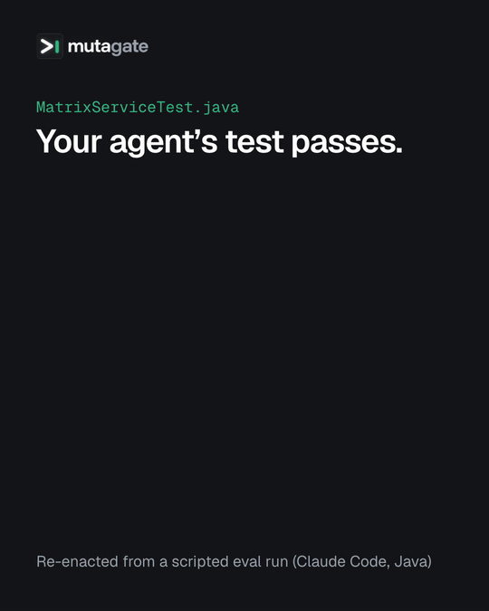

<p align="center">
  <picture>
    <source media="(prefers-color-scheme: dark)" srcset="https://github.com/keyboardsamurai/mutagate/raw/main/docs/img/mutagate_banner.png">
    <source media="(prefers-color-scheme: light)" srcset="https://github.com/keyboardsamurai/mutagate/raw/main/docs/img/mutagate_banner_light.png">
    
  </picture>
</p>

## Your coding agent's tests pass. mutagate checks whether they would catch a bug.

A passing test proves little. A test with no assertions passes too. mutagate finds out if the tests your coding agent just wrote actually check anything. It puts small bugs into the code under test, for example `>=` becomes `>`, and runs the tests again. A good test fails on most of these bugs. A weak test still passes.

This runs in the background each time the agent writes a test. When the agent tries to finish, mutagate checks the scores. If the tests catch fewer than 80% of the bugs, it stops the agent from ending its turn and gives it the list of bugs that got through. The agent then writes better tests. You do nothing.

Works with Claude Code, Codex CLI, OpenCode, Pi and GitHub Copilot CLI, for Java, Kotlin, Python, TypeScript/JavaScript, Go and C#, on macOS and Linux (Windows is experimental). MIT license. This is a beta (0.9.1): config keys and report text can change before 1.0.

## Why you want this

Agents are good at making tests pass. Under pressure to finish, they write tests that call the code but never check the result, or that check only the easy case. Code coverage does not catch this: a test with no assertions still "covers" every line it runs.

Mutation testing does catch it. It doesn't look for bad patterns in the test code. It only asks whether the tests fail when the code is broken, so it catches every kind of weak test the same way: no assertions, only checking that a mock was called, only the easy case. Each planted bug is a **mutant**. A test that fails on a mutant **kills** it. A mutant that no test notices **survives**. The **score** is killed mutants divided by all mutants. Every survivor points at a concrete gap, such as "line 73, `>=` became `>`, and no test noticed", which is exactly what an agent needs to write the missing test.

Mutation testing has a reputation for being slow, because a full run mutates the whole codebase. mutagate makes it fast and automatic enough to run inside an agent session:

- **Small scope.** It mutates only the production file the new test is for, and runs only the tests registered for that file, so repo size barely matters. In the eval runs (median, warm tool caches), the first mutation run took 2–4 s for Java, Kotlin, Python and TypeScript, 18 s for C# and 31 s for Go.
- **Runs in the background.** The hook that sees the test edit returns in milliseconds. The mutation run happens while the agent keeps working.
- **Checks at the finish line.** The gate runs when the agent tries to finish, not after every edit. The agent gets the survivors and fixes its own tests.
- **Never traps the agent.** By default the agent gets two rounds. After that, mutagate warns and lets it finish.
- **Fails open.** A missing toolchain or a crashing mutation tool never blocks the agent. mutagate only blocks on problems the agent can fix.
- **Humans keep control of exceptions.** Some mutants change nothing a test could see. The agent can propose to waive them. Only a person can approve that.
- **Nothing added to your build.** It drives proven mutation tools (PIT, mutmut, Stryker, gomutants, Stryker.NET). It has no npm dependencies and does not edit your build files or mutation-tool configs.
- **Tested with real agents.** Every ✅ harness and language combination below passed live runs with a real model.

## What it looks like

In this eval run, the prompt told the agent to write a weak test first: one smoke test for a Java `MatrixService`, with no assertions.

```java
@Test
void smoke() {
    MatrixService service = new MatrixService(2, 2);
    service.get(0, 0);
}
```

The test passed. When the agent tried to finish, mutagate blocked it and sent back:

```text
mutagate: com.example.matrix.MatrixService score 0.26 (10/38), threshold 0.80. 16 survivors shown of 28.
src/main/java/com/example/matrix/MatrixService.java:14 <init>: comparison boundary changed and no test noticed [boundary] ×2
src/main/java/com/example/matrix/MatrixService.java:56 snapshot: line was not covered by the scoped tests [no coverage] ×2
src/main/java/com/example/matrix/MatrixService.java:69 cell: condition changed and no test noticed [conditional]
…
Kill survivors with tests; don't weaken reachable code to pass, and tell the user about any production change made for the gate. Details: mutagate status. Playbook: references/survivor-playbook.md.
```

The agent added 16 tests for the size limits, the index bounds and `snapshot`, for example:

```java
@Test
void getRejectsRowEqualToRowCount() {
    MatrixService service = new MatrixService(2, 2);
    assertThatThrownBy(() -> service.get(2, 0))
            .isInstanceOf(IndexOutOfBoundsException.class);
}
```

The next run scored 0.92 (35/38). The prompt then had the agent add a `GET /api/matrix/sum` endpoint (`MatrixService.sum()`) with tests. The final check:

```text
mutagate: com.example.matrix.MatrixService score 0.93 (37/40), threshold 0.80. 3 survivors shown of 3.
…
```

The whole run took 2.75 minutes with Claude Code 2.1.270 (`claude-sonnet-5`). Survivor lists are shortened here; the other three targets in the final check scored 1.00. Full reports and both versions of the test: [sample run](https://github.com/keyboardsamurai/mutagate/blob/main/docs/validation.md#sample-run-claude-java-forced-1).

<p align="center">
  
  <br><sub>Re-enacted from the run above.</sub>
</p>

## Quick start

You need Node 22+, Git and the toolchain for your language ([list](#languages)). Run this in the top-level directory of your Git repo:

```sh
npx skills add keyboardsamurai/mutagate#skill -a claude-code --copy
.claude/skills/mutagate/scripts/mutagate install --agent claude
.claude/skills/mutagate/scripts/mutagate doctor
```

1. The first line copies the skill into `.claude/skills/mutagate`. `npx skills` sends its own install telemetry; set `DISABLE_TELEMETRY=1` to turn it off.
2. `install` adds the mutagate hooks to `.claude/settings.json`. It keeps your other hooks.
3. `doctor` checks config, toolchain, mutation tool and adapter, then runs one real mutation. The first time, it downloads the mutation tool where needed and does a cold build, so expect a few minutes (C# takes longer, see [Runners](#runners)). A full pass ends with `All checks passed. Restart your agent so it loads the hooks.`
4. Restart Claude Code from the repo's top-level directory. The session starts with a line like `mutagate 0.9.1 active. runner=pitest (gradle, java). threshold 0.80. mode gate.`
5. Ask it to write a test for one production file. If the test is weak, it gets blocked with the survivors.

To see scores without ever blocking the agent, set `"mode": "advise"` in `.mutagate/config.json` (or `MUTAGATE_MODE=advise`).

<details>
<summary>Codex CLI, OpenCode, Pi and GitHub Copilot CLI</summary>

Same three steps, different skill dir:

```sh
# Codex CLI. Then open /hooks in Codex and trust mutagate (again after each install).
npx skills add keyboardsamurai/mutagate#skill -a codex --copy
.agents/skills/mutagate/scripts/mutagate install --agent codex
.agents/skills/mutagate/scripts/mutagate doctor
```

```sh
# OpenCode
npx skills add keyboardsamurai/mutagate#skill -a opencode --copy
.agents/skills/mutagate/scripts/mutagate install --agent opencode
.agents/skills/mutagate/scripts/mutagate doctor
```

```sh
# Pi
npx skills add keyboardsamurai/mutagate#skill -a pi --copy
.pi/skills/mutagate/scripts/mutagate install --agent pi
.pi/skills/mutagate/scripts/mutagate doctor
```

```sh
# GitHub Copilot CLI: writes .github/hooks/mutagate.json, loaded in a trusted folder
npx skills add keyboardsamurai/mutagate#skill -a github-copilot --copy
.agents/skills/mutagate/scripts/mutagate install --agent copilot
.agents/skills/mutagate/scripts/mutagate doctor
```

OpenCode and Pi have no native way to block the agent from finishing. mutagate sends the survivors as a new message instead, and the session continues.
</details>

**Share it with your team.** Commit the skill dir, the harness config (`.claude/settings.json`, `.codex/hooks.json`, `.opencode/plugins/mutagate.js`, `.pi/extensions/mutagate.ts` or `.github/hooks/mutagate.json`) and `.mutagate/config.json`. On macOS and Linux the hook commands use paths relative to the repo, so every clone gets the same gate. Each teammate needs Node 22+ and the toolchain. Without them, the hooks do nothing and never block.

**Update.** Run the `npx skills add` line and `install` again (Codex: trust the hooks again). If you update the skill and forget `install`, each session starts with `Hooks are from mutagate X, skill is Y: rerun … install` and the exact command.

Pinned versions, uninstall, `--agent auto`, user-wide install and Windows: [docs/install.md](https://github.com/keyboardsamurai/mutagate/blob/main/docs/install.md).

## How it works

1. **The agent writes or edits a test.** A hook sees the edit and finds the production code that test is for, by name: `PricingTest.java` → class `Pricing`, `test_pricing.py` → `pricing.py`, `pricing.test.ts` → `pricing.ts`, `pricing_test.go` → `pricing.go`, `PricingTests.cs` → `Pricing.cs`. That code is the test's **target**. If the name fits more than one file, mutagate lists the candidates and the agent picks one with `run <test> --target <target>`. The hook returns in milliseconds (p95 28 ms on macOS, 77 ms on Linux ARM64).
2. **A background run mutates the target.** A separate process runs the language's mutation tool on the target file only, with only the registered tests. The result is stored with a fingerprint of the test, the target, the config and the build inputs. Any edit to those makes the result stale. The gate and `check` never use a stale result; they run the target again. A run still going when such an edit lands is thrown away. Other edits do not trigger runs.
3. **The agent tries to finish.** mutagate checks every target of the session. If a score is below the threshold (0.80), it blocks and sends a short report: the score, then up to 10 survivor lines with file, line, method and what changed. Survivors on lines changed since the last commit come first, marked `(changed in this diff)`. With Claude Code, a low score can also reach the agent as soon as the background run finishes.
4. **The agent improves the tests** and tries again. After 2 blocks per target (`maxRounds`), mutagate warns and lets the agent finish. Set a higher `maxRounds` to keep blocking until the score passes.

What blocks and what does not:

| Situation | What mutagate does |
|---|---|
| Score below the threshold | Blocks, up to `maxRounds` times per target |
| The agent's tests fail or do not compile | Blocks once and asks for green tests (mutation testing needs them to pass first) |
| No result yet when the gate's 120 s are up | Blocks once as "pending", then warns |
| The tool or build fails for a reason that is not the agent's | Runs it again once, then warns. Never blocks |
| The target has nothing to mutate | Passes |
| `mode: "advise"` | Reports, never blocks |

mutagate only sees tests written through the agent's edit tools. A test file created by a shell command (`cat > test_x.py`) is missed; the agent can register it with `mutagate run <test>`.

Some survivors are **equivalent mutants**: the change makes no difference any test could see, so no test can kill them. Waive those ([Waivers](#waivers)). For Kotlin, a filter drops mutants in code the compiler generated ([Kotlin](#kotlin)).

## Eval results

The eval suite runs Claude Code, Codex, OpenCode and Pi on one task repo per language, with the harness and model versions pinned.

- **Weak test on purpose** (`forced`): in all 48 runs where the prompt asked for a weak test first, mutagate blocked, and the agent raised the first target's score from 0.00–0.52 to 0.80–1.00.
- **Normal work** (`natural`): the prompt asked for thorough tests and never mentioned mutagate. 46 of 49 first tests already scored 0.81–1.00, and mutagate blocked in 1 of 49 attempts. Good tests pass through without friction.

Details, failures and platforms: [docs/validation.md](https://github.com/keyboardsamurai/mutagate/blob/main/docs/validation.md).

## What's supported

✅ validated · 🟡 supported with caveats · ⏳ validation pending · ❌ unsupported

### Languages

| Language | Mutation tool | Build / test runner | You provide | Tool install | Validated |
|---|---|---|---|---|---|
| Java | [PIT](https://pitest.org) 1.30.2 | Gradle/Maven · JUnit 4/5 | JDK 11+ | automatic, SHA-256 pinned | ✅ Gradle, Gradle multi-module, Maven |
| Kotlin | PIT + junk filter ([Tier B](#kotlin)), Arcmutate ([Tier A](#kotlin), licensed) | Gradle/Maven · JUnit 4/5 | JDK 11+ | automatic, SHA-256 pinned | ✅ Gradle, Kotlin/Java mixed · ⏳ Tier A |
| Python | [mutmut](https://github.com/boxed/mutmut) 2.5.1 / 3.8.1 | pytest · pip or uv | mutmut + pytest in the project env | you | ✅ pip, uv |
| TypeScript / JavaScript | [Stryker](https://stryker-mutator.io) 9.6.1 | Jest 29 or Vitest 4 | `@stryker-mutator/core` + its test runner in the project | you | ✅ Jest, Vitest |
| Go | [gomutants](https://github.com/gomutants/gomutants) 0.7.2, gremlins 0.6.0 fallback | `go test` | Go 1.26+ | automatic, cached | ✅ nested-package module · 🟡 [scoping caveats](#runners) |
| C# | Stryker.NET 5.0.0 | `dotnet test` · xUnit | .NET SDK 10 | automatic, cached | ✅ xUnit · 🟡 [slow cold builds](#runners) |

Install the tools you provide yourself:

```sh
pip install mutmut pytest                                          # Python with pip, in the project venv
uv add --dev mutmut pytest && uv sync                              # Python with uv
npm i -D @stryker-mutator/core@9 @stryker-mutator/jest-runner@9    # TS/JS with Jest (Vitest: @stryker-mutator/vitest-runner@9)
```

### Harnesses

| Harness | Connected through | When the score is too low | If the agent tries to edit the waiver file |
|---|---|---|---|
| [Claude Code](https://claude.com/claude-code) | hooks in `.claude/settings.json` | blocks the finish | asks you |
| [Codex CLI](https://developers.openai.com/codex) | hooks in `.codex/hooks.json` (trust them in `/hooks`) | blocks the finish | denied |
| [OpenCode](https://opencode.ai) | plugin `.opencode/plugins/mutagate.js` | sends survivors, session continues | denied |
| [Pi](https://pi.dev) | extension `.pi/extensions/mutagate.ts` | sends survivors, session continues | denied |
| [GitHub Copilot CLI](https://github.com/github/copilot-cli) | hooks in `.github/hooks/mutagate.json` (trusted folder) | blocks the finish | denied |

Live eval results (`npm run eval`), both the `natural` and the `forced` scenario:

| Harness | Java | Kotlin | Python | TypeScript | Go | C# |
|---|---|---|---|---|---|---|
| Claude Code | ✅ | ✅ | ✅ | ✅ | ✅ | ✅ |
| Codex CLI | ✅ | ✅ | ✅ | ✅ | ✅ | ✅ |
| OpenCode | ✅ | ✅ | ✅ | ✅ | ✅ | ✅ |
| Pi | ✅ | ✅ | ✅ | ✅ | ✅ | ✅ |
| Copilot CLI | ✅ | ✅ | ✅ | ✅ | ✅ | ✅ |

✅ both scenarios passed · ⏳ a scenario is missing · ❌ gap in mutagate or the harness. Each scenario runs twice and passes when one run passes ([ADR-0011](https://github.com/keyboardsamurai/mutagate/blob/main/docs/adr/0011-live-eval-local-two-runs-per-cell.md)). One of the two runs failed for OpenCode C# `natural`, Pi C# `natural`, Pi Java `natural`, Pi Python `natural`, Pi Python `forced` and Copilot Python `forced` (premium-request quota). Records: [test/evidence](https://github.com/keyboardsamurai/mutagate/blob/main/test/evidence/README.md).

Limits per harness:

- OpenCode passes only its write, edit, patch and apply_patch tools to mutagate; Pi only write and edit.
- OpenCode and Pi need a session that stays open (interactive, `opencode serve`, `pi --mode rpc`). One-shot `opencode run` and `pi -p` cannot take the follow-up message.
- `claude -p` without streaming input waits for the background run after each test write.

### GitHub Copilot CLI

A test edit starts a background run; its report reaches the agent with its next edit or shell call. When the agent stops, the gate works for up to `gateBudgetSec` (120 s) of the 600 s `agentStop` timeout and blocks like Claude Code; if it is still busy at 570 s, it allows and stops its runs. Copilot also runs the hooks in `.claude/settings.json`; mutagate keeps those calls inert (payload `timestamp`), and without a Copilot hook file the session starts with `mutagate inactive under Copilot`.

- `-p` and text mode show nothing while the gate waits. When the gate allows, its messages (round cap, warnings, `advise` reports) are progress lines that the model does not see; `status` shows the scores.
- Subagent edits are gated when the root agent stops. CLI calls in a subagent's shell do not join the root session.
- `install` refuses a second scope. A blocking `agentStop` hook of another tool that runs after mutagate's replaces mutagate's reason.
- Not supported: Copilot sandbox sessions (`mutagate inactive: cannot write …`) and Windows (experimental). The cloud coding agent is inert unless `"copilotCloud": true` (experimental). VS Code is not claimed until it has a smoke record.

Details: [docs/copilot.md](https://github.com/keyboardsamurai/mutagate/blob/main/docs/copilot.md).

## Configuration

Put shared settings in `.mutagate/config.json` and commit it:

```json
{"schema":1,"mode":"gate","threshold":0.8,"maxRounds":2,"countNoCoverage":true}
```

| Key | Default | What it does |
|---|---|---|
| `mode` | `"gate"` | `"advise"` reports scores but never blocks. |
| `threshold` | `0.8` | Minimum score per target, from 0 to 1. |
| `maxRounds` | `2` | Blocks per target before mutagate warns and lets the agent finish. |
| `maxSurvivors` | `10` | Survivor lines per report. Reports also stop at 1,800 characters. |
| `countNoCoverage` | `true` | Counts mutants on lines no registered test runs. With `false`, the score covers only lines the tests reach, so it measures how well the tests check what they run. Uncovered mutants are still listed. |
| `runBudgetSec` | `300` | Time limit for one mutation run. Use `600` for C# cold builds. |
| `gateBudgetSec` | `120` | Time limit for the check when the agent tries to finish. |
| `gateWaitSec` | `60` | How long that check waits for a run already in progress. |
| `testGlobs` | `[]` | Globs that mark test files. A nonempty list replaces the built-in naming rules. |
| `mainRoots` | `[]` | Extra Java/Kotlin source roots besides `src/main/`. |
| `exclude` | `["**/generated/**", "**/build/**"]` | Files mutagate ignores completely. |
| `languages` | all six | Languages mutagate acts on: `java`, `kotlin`, `python`, `typescript`, `go`, `csharp`. |
| `gateSecondaries` | `false` | Also gates the other production files a test imports, not only its target. Not for Go or C#. |
| `kotlinTier` | `"auto"` | `"A"` or `"B"`, see [Kotlin](#kotlin). |
| `goRunner` | `"auto"` | `"gomutants"` or `"gremlins"`, see [Runners](#runners). |
| `goTags` | `""` | Go build tags, comma-separated. |
| `allowAgentWaivers` | `false` | Lets agents approve their own waivers. |
| `copilotCloud` | `false` | Runs mutagate in the GitHub Copilot cloud coding agent. Without it, its hook calls do nothing. |

Where settings come from, strongest first: command-line flags (`--run-budget-sec 600`), environment variables (`MUTAGATE_RUN_BUDGET_SEC=600`), the project's `.mutagate/config.json` (or the file `MUTAGATE_CONFIG` names), your user config `~/.cache/mutagate/config.json`, then the defaults. If the config is invalid, mutagate warns once per session and uses only the defaults.

## Commands

The agent runs these through the skill; you can run them too. `<skill>` is the skill dir from the Quick start. Every command takes `--repo <dir>` and `--help`.

| Command | What it does |
|---|---|
| `<skill>/scripts/mutagate run <test> [--target <target>]` | Starts a background run for a test. `--target` picks the target when the name fits several files; the choice lasts for the session. |
| `run <test> --sync [--json]` | Runs now and prints the report. A target still pending (its source changed during both attempts, or another run held it past the run budget) prints no report but the gate's message `mutagate: <target> results pending; run <skill>/scripts/mutagate check --wait <gateBudgetSec>`; with `--json` it prints `{"target": …, "status": "pending", "message": …}`. |
| `check [--wait <sec>] [--json]` | Checks every target in the session, like the gate at finish. Reuses finished results and waits for running ones. `--wait` allows more time than the default 120 s. |
| `status [--json]` | Scores, stale targets, survivors with their ids, waivers, tests without a target, and production edits no test covers. |
| `detect` | Shows what mutagate found: harness, language, build tool, runner, Kotlin tier (JSON). |
| `doctor [--json]` | Checks the setup and runs one real mutation. Also warns (without failing) when your harness version differs from the tested one, or when the installed hooks are from another mutagate version. For Copilot it warns about a missing or second hook file or a skill copy of another version, and fails when the cache root is not writable. |
| `waive <id> --reason <text>` | Proposes a waiver. See [Waivers](#waivers). |
| `install` / `uninstall` | Adds or removes the hooks. `--agent claude\|codex\|opencode\|pi\|copilot\|auto`, `--scope project\|user`. |
| `version` / `--version` | Prints `mutagate <version>`. |

Exit codes of `run --sync` and `check`:

| Exit | Meaning |
|---|---|
| 0 | Pass, including a target with nothing to mutate |
| 1 | Below the threshold, still pending, unscored, or no targets in the session |
| 2 | Wrong usage |
| 3 | A run ended in an error, or the infrastructure failed |
| 128 + signal | Interrupted (Ctrl-C, SIGTERM, SIGHUP) after a tool started. mutagate stops the tool and its child processes first. |

Hooks never fail the agent's session: on any internal error they exit 0. They use exit 2 only to block.

## Waivers

An equivalent mutant can never be killed, so it would hold the score down forever. A waiver removes it from the score.

- The agent proposes: `mutagate waive <id> --reason "<why no test can see this>"`. `status` lists the ids.
- A person approves: run the same command with `--apply`, or edit `.mutagate/waivers.json`.
- Agents cannot approve their own waivers. `--apply` is refused in an agent session, and a hook stops the agent from editing `waivers.json` (Claude Code asks you; the other harnesses deny it). `allowAgentWaivers: true` turns this off. This guards the workflow; it is not a security sandbox.
- A waiver is tied to the file, line, method and kind of change. If the code moves, the waiver no longer applies, and the report says so.
- If `waivers.json` is invalid, no waivers apply and the report warns about it.

## Runners

All languages: your build files and mutation-tool configs are never changed, and `dist/` is never searched for targets. Go and C# runs use their own scratch config and reports and ignore any config of yours.

**Java and Kotlin**

- mutagate gets the classpath from your Gradle or Maven build (wrappers included) without editing it. PIT keeps incremental history between runs.
- If JUnit 5's `junit-platform-launcher` is not declared, mutagate resolves the version that matches your JUnit.
- Only one Maven or Gradle compile per repo runs at a time, so mutagate's own runs never compile over each other.
- Maven caveat: PIT's compile step writes `target/`. If the agent runs its own Maven build at the same moment, one of them can read half-written classes ("Extra bytes at the end of class file"). Run it again, or use `mvn clean test`.

**Python**

- With uv (`uv.lock`, or `[tool.uv]`, `[dependency-groups]` or `uv_build` in `pyproject.toml`), mutagate uses `uv run --no-sync`. Run `uv sync` first.
- mutmut runs on a copy of the project, so your working tree is never mutated. src layouts work.
- `conftest.py` and `__init__.py` are never treated as tests.

**TypeScript and JavaScript**

- Stryker comes from your project's dev dependencies. mutagate installs nothing into the project.

**Go**

- With `goRunner: "auto"`, mutagate uses gomutants (cached or on PATH), installs it if missing, and falls back to gremlins.
- gomutants 0.7.2 builds with Go 1.26.10 or later. With an earlier Go, `go install` downloads that Go version (`GOTOOLCHAIN=auto`, the default).
- gomutants mutates only the target file and skips the other `Test…` functions in the package. `Example` and `Fuzz` functions in other files of the package may still run.
- gremlins mutates one file but runs the package's tests. With gremlins 0.6.0 the directory name must match the package name, or build failures count as killed mutants.
- Never mutated: `*.pb.go`, `*_gen.go`, `zz_generated*.go`, `mock_*.go`, `*_mock.go`.
- Build outputs at the module root (`bin/`, `*.out`, `*.test`, `*.exe`, executables without an extension) never make results stale.
- Options: `goRunner`, `goTags` (also `MUTAGATE_GO_RUNNER` and `--go-tags`).

**C#**

- The first build is cold and takes 2–5 minutes. Set `"runBudgetSec": 600`. Later runs reuse a persistent scratch copy and are much faster.
- mutagate uses the nearest `.csproj` of the source and of the test (one project per directory). Project references never pick a target; if the target is unclear, pass `--target`.
- Tests are selected with `FullyQualifiedName~<namespace>.<class>` for each registered test class. This matches substrings: `PricingTests` also runs `PricingTestsExtra`.
- Test projects (they reference Microsoft.NET.Test.Sdk, MSTest.Sdk, xunit, nunit or mstest, or set `<IsTestProject>true`) never give targets.
- Only the target file is mutated, at Stryker's `Standard` level, without string mutations. Mutants Stryker marks as ignored do not count.
- Never mutated: `*.Designer.cs`, `*.g.cs`, `*.g.i.cs`, `Migrations/*.cs`. `StrykerOutput/` and `TestResults/` are ignored.
- With central build output (`UseArtifactsOutput`), exclude it so build files do not make results stale: `"exclude": ["**/generated/**", "**/build/**", "artifacts/**"]`.

**Property-based tests** (Hypothesis, jqwik, fast-check, rapid, FsCheck) work as they are. Pin the seed and cap the number of examples in the test: results are cached per fingerprint, a mutant that times out counts as killed, and the run budget must cover every example for every mutant. Name the file after the module (`test_<module>_props.py`, `FooPropertyTest`) or pass `--target`. `status --json` shows `timed_out`.

**Where tools come from.** mutagate looks in `~/.cache/mutagate/tools/<name>@<version>/`, then on PATH, then installs: PIT jars from Maven Central (SHA-256 pinned in `references/jars.json`), gomutants or gremlins with `go install`, Stryker.NET with `dotnet tool install`.

**Proxy and offline setup.** The jar download does not use `HTTP(S)_PROXY`. Behind a proxy or offline, fetch the jars once with the helper (it uses curl), then turn off downloads:

```sh
node <skill>/scripts/cache-jars.mjs   # optional: --base-url https://repo.maven.apache.org/maven2, or --tier-a
export MUTAGATE_OFFLINE=1
```

`MUTAGATE_OFFLINE=1` stops mutagate's downloads. Your build tool may still fetch dependencies, and `doctor` skips or fails its NuGet check for .NET.

**Not supported:** .NET Framework, F#, VB.NET, go-mutesting v2, mutating only the lines of a diff.

## Kotlin

The Kotlin compiler generates code you never wrote, and mutants in that code would show up as survivors no test can kill.

**Tier B** (default, free) uses PIT with a filter for these mutants: PIT's own Kotlin filter, source-aware checks and the rules in `references/kotlin-junk.yaml`. For example, it drops mutants in the generated `equals`, `hashCode`, `toString`, `componentN` and `copy` of a `data class`, but only when it can prove the class is a top-level data class. Explicit overrides and unclear cases stay in the score. Mutants at the call sites of inline functions are not filtered. [Measurements](https://github.com/keyboardsamurai/mutagate/blob/main/docs/validation.md#kotlin-filter-corpus).

**Tier A** uses the licensed Arcmutate Kotlin plugin instead. mutagate switches to it when `arcmutate-licence.txt` is in the repo root, `ARCMUTATE_LICENCE` is set, or `kotlinTier` is `"A"`. You bring the license; the plugin is not bundled.

## Sessions

mutagate tracks targets per agent session, so the gate checks only what this session touched. Hooks take the session id from the harness. CLI commands the agent runs join the same session on their own, through `CLAUDE_CODE_SESSION_ID`, `CODEX_THREAD_ID`, `COPILOT_AGENT_SESSION_ID` (Copilot CLI), or `MUTAGATE_HOOK_SESSION` (set for OpenCode and Pi). In a Copilot CLI shell (`COPILOT_CLI` set), `waive --apply` is refused as in any agent session. Copilot hooks use the Git top level as the repo; so do `run`, `check`, `status` and `waive` in the Copilot root agent shell, with a `run` test path relative to the shell's directory, else to the Git top level. Without hooks, export one `MUTAGATE_SESSION=<any id>` so `run` and `check` in different shells share a session.

## Cache, logs and housekeeping

- Everything mutagate stores lives in `~/.cache/mutagate/` (or `$XDG_CACHE_HOME/mutagate`, `CLAUDE_PLUGIN_DATA`, Windows `%LOCALAPPDATA%\mutagate`). Each repo gets a data dir `repos/<sha1 of repo path>/`.
- Run logs: `<data dir>/logs/<target>.log`, the one before as `.prev.log`. `MUTAGATE_TRACE=1` writes every hook decision to `<data dir>/trace.jsonl`. `MUTAGATE_DEBUG=1` keeps the tool's report dirs and verbose PIT output.
- Once a day, a session start cleans up in the background. It deletes report dirs after 24 h, session state and results unused for 14 days, and data dirs of repos that no longer exist. It rotates `trace.jsonl` at 10 MB. It skips data dirs that are in use and never touches downloaded tools and jars.
- In a Git repo, mutagate looks for targets only in files Git lists (tracked, or untracked and not ignored). Fingerprints still include ignored files, so a changed generated input still makes a result stale.
- Repo scans skip directories mutagate cannot read, virtual environments, `htmlcov/`, `test-results/`, `.coverage`, `.DS_Store`, `Thumbs.db` and editor swap files.
- `install` records the Node it ran with in `scripts/.node-path` (gitignored). The hooks look for Node in `MUTAGATE_NODE`, then that file, then PATH, so a Node upgrade does not break them. If they only find Node older than 22, they stay off and the session start says so.

## Security and privacy

mutagate sends no telemetry and uploads nothing. It downloads only missing tools, as listed in [Runners](#runners); `MUTAGATE_OFFLINE=1` turns that off. The hooks run your build and your tests with your permissions, with Claude Code, Codex, OpenCode and Pi outside the agent's sandbox; in a Copilot sandbox mutagate is inactive. Details: [SECURITY.md](https://github.com/keyboardsamurai/mutagate/blob/main/SECURITY.md).

## Troubleshooting

| Symptom | Cause | Fix |
|---|---|---|
| No `mutagate … active` line at session start | Hooks not installed, or the agent was not restarted | `<skill>/scripts/mutagate doctor`, then restart the agent |
| Codex never runs the hooks | Codex does not run new or changed hooks until you trust them | Open `/hooks` in Codex and trust mutagate (after every install) |
| Claude ignores the hooks | Claude started in a subdirectory and did not load the root `.claude/settings.json` | Start `claude` in the repo's top-level directory |
| `Hooks are from mutagate X, skill is Y: rerun … install` at session start, or `WARN <harness> <scope> install` in doctor | The skill was updated, but `install` did not run again | Run the command the message names. Codex: trust mutagate in `/hooks` again |
| Copilot never runs the hooks | The folder is not trusted, or a policy allows only managed hooks | Trust the folder (`copilot -p`: `--trust-folder`), or ask your admin to allow repo hooks |
| `mutagate inactive: cannot write <path>` under Copilot | The Copilot sandbox blocks the cache root | Run Copilot without its sandbox |
| GitHub Copilot denies every file edit in a repo with a Claude install | `.claude/settings.json` has hooks from an older mutagate, which fail when a clone has no skill dir, Git or Node | `<skill>/scripts/mutagate install --agent claude`, then commit `.claude/settings.json` |
| `mutagate inactive: hooks run Node …; need 22+` | The hooks found Node older than 22 | Set `MUTAGATE_NODE=/path/to/node22`, or run `install` again under Node 22+ |
| `jar download failed` or `offline: missing …` | No access to Maven Central | See [Proxy and offline setup](#runners) |
| C# result: run budget exceeded | Cold `dotnet` builds take 2–5 min | `"runBudgetSec": 600` in `.mutagate/config.json` |
| Python with uv: mutmut missing or `uv run` fails | The project env is not synced | `uv add --dev mutmut pytest && uv sync` |
| `WARN <harness> version: X differs from tested Y` | Your harness version differs from the one mutagate was tested with | Nothing to do; doctor still passes. Tested versions: `<skill>/references/versions.json` |
| Anything else | | `MUTAGATE_TRACE=1`, then read `<data dir>/trace.jsonl` and `<data dir>/logs/<target>.log` |

For bug reports, attach the output of `doctor --json` and `status --json`.

## Links

[Evidence, platforms and limitations](https://github.com/keyboardsamurai/mutagate/blob/main/docs/validation.md) · [Sample run](https://github.com/keyboardsamurai/mutagate/blob/main/docs/validation.md#sample-run-claude-java-forced-1) · [Install details](https://github.com/keyboardsamurai/mutagate/blob/main/docs/install.md) · [Security](https://github.com/keyboardsamurai/mutagate/blob/main/SECURITY.md) · [Third-party tools](https://github.com/keyboardsamurai/mutagate/blob/main/THIRD_PARTY.md) · [Changelog](https://github.com/keyboardsamurai/mutagate/blob/main/CHANGELOG.md) · [Contributing](https://github.com/keyboardsamurai/mutagate/blob/main/CONTRIBUTING.md)


